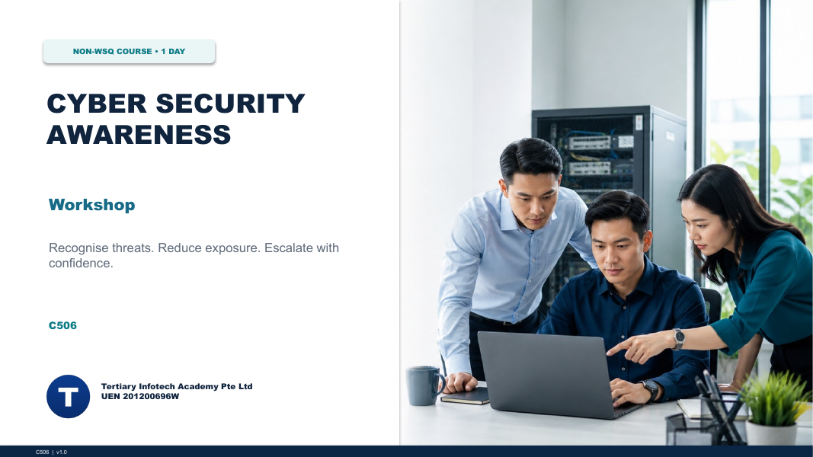

# Cyber Security Awareness Workshop

A one-day, beginner-friendly workshop on recognising cyber threats, reducing exposure and escalating incidents with confidence — for individuals and businesses.

| Course detail | Information |
|---|---|
| Course code | `C506` |
| Programme | Non-WSQ |
| Duration | 1 day, 9:30am – 5:30pm (7.5 instructional hours) |
| Registration | [View course details and register](https://www.tertiarycourses.com.sg/cyber-security-awareness-workshop.html) |

## About the course

Discover how to fortify your digital world against cyber threats. Learn the fundamentals of online safety, data protection and cybersecurity — password management, phishing prevention and secure browsing — then apply them to protect both personal data and a business's confidential information. Real-world cases (SingHealth, WannaCry, Colonial Pipeline, MOVEit and more), synthetic phishing/BEC/smishing examples and ten mock-data labs turn the concepts into practical decisions.

## Learning outcomes

- LO1: Identify cyber security risks and threats affecting people and organisations
- LO2: Apply safeguards to protect personal information and everyday digital activity
- LO3: Apply business safeguards and interpret incidents that require escalation

## Topics covered

1. **Topic 1: Identify cyber risks and threats** — threat actors, attack chains, malware types, social engineering and BEC, network and mobile threats, real-world cases
2. **Topic 2: Protect personal information** — passwords and MFA, device baseline, backups, safer browsing and online transactions, account recovery
3. **Topic 3: Protect business information** — vulnerabilities and risk prioritisation, web risk, detection, authorised testing, governance, continuity and incident escalation

## Labs

Each lab is a self-contained folder under [`labs/`](labs/) with a scenario, procedure, checklist, evidence template and mock data, in Markdown and PDF. All data is synthetic.

1. [Lab-01: Threat Triage with the Cybersecurity Simulator](labs/Lab-01-threat-triage/README.md)
2. [Lab-02: Detect Phishing and Business Email Compromise](labs/Lab-02-phishing-bec/README.md)
3. [Lab-03: Recognise Malware and Endpoint Warning Signs](labs/Lab-03-malware-signals/README.md)
4. [Lab-04: Prioritise Vulnerabilities by Business Risk](labs/Lab-04-vulnerability-prioritisation/README.md)
5. [Lab-05: Authorised Web-Risk Review in FauxBank](labs/Lab-05-fauxbank-web-risk/README.md)
6. [Lab-06: Protect Data with Hashing and Encryption](labs/Lab-06-cryptography-safeguards/README.md)
7. [Lab-07: Map Network Exposure and Segmentation](labs/Lab-07-network-exposure/README.md)
8. [Lab-08: Triage Suspicious Network Traffic](labs/Lab-08-packet-triage/README.md)
9. [Lab-09: Design and Test a Detection Rule](labs/Lab-09-detection-rule/README.md)
10. [Lab-10: Integrated Incident Response and Escalation](labs/Lab-10-incident-escalation/README.md)

## Courseware package

| Artifact | Files |
|---|---|
| Trainer slides | [PPTX](courseware/Cyber%20Security%20Awareness%20Workshop-v1.0.pptx) · [PDF](courseware/Cyber%20Security%20Awareness%20Workshop-v1.0.pdf) |
| Learner Guide | [DOCX](courseware/LG-Cyber%20Security%20Awareness%20Workshop.docx) · [PDF](courseware/LG-Cyber%20Security%20Awareness%20Workshop.pdf) |
| Lesson Plan | [DOCX](courseware/LP-Cyber%20Security%20Awareness%20Workshop.docx) · [PDF](courseware/LP-Cyber%20Security%20Awareness%20Workshop.pdf) |

## Safety

The named web tools are used only as authorised training environments. All supplied identities, domains, IP addresses and records are synthetic. Never test real systems without explicit written authorisation.

---

© Tertiary Infotech Academy Pte Ltd · UEN 201200696W · [www.tertiarycourses.com.sg](https://www.tertiarycourses.com.sg/)
